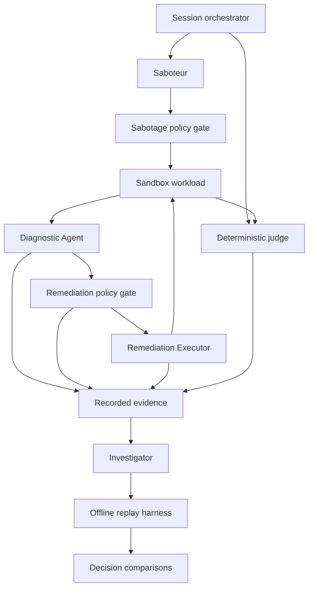

# Azure Kubernetes Agentic Ops Lab

A four-role experimental lab for evaluating the reliability and security of agent-assisted Kubernetes operations.

> **Status: concept and roadmap.** This repository currently documents the planned system. The agents, replay harness and experiments described below are not implemented here yet.

**The model proposes; deterministic policy authorizes; execution is verified.**

## Project series

| Repository | Focus |
| --- | --- |
| [azure-kubernetes-agentic-ops-poc](https://github.com/JeanneBM/azure-kubernetes-agentic-ops-poc) | Initial operational prototype |
| [azure-kubernetes-agentic-ops-eval](https://github.com/JeanneBM/azure-kubernetes-agentic-ops-eval) | Controlled scenarios and evaluation evidence |
| **azure-kubernetes-agentic-ops-lab** | Automated experiments, adversarial scenarios and decision replay |

This lab builds on the diagnostic and deterministic remediation design explored in the previous projects. Existing code and scenarios will be reviewed and adapted incrementally; this repository does not claim that earlier results validate the new system.

## Purpose

Move from manually running individual scenarios to bounded experimental sessions:

1. Establish a healthy baseline.
2. Introduce a controlled fault.
3. Let the diagnostic agent investigate and propose a response.
4. Authorize or reject the action through deterministic policy.
5. Verify recovery, scope compliance and possible regressions.
6. Record the evidence, reset the environment and select the next experiment.

The goal is to measure both successful operations and failure boundaries, including unsafe proposals, blocked actions, incomplete experiments and inconclusive findings.

## Four roles

| Role | Responsibility | Execution boundary |
| --- | --- | --- |
| **Diagnostic Agent** | Collect observations, diagnose the incident and propose a structured action | Cannot directly mutate the cluster |
| **Remediation Executor** | Validate and execute explicitly permitted actions | Deterministic execution behind a policy gate; no LLM required |
| **Saboteur Agent** | Select controlled faults and injection scenarios, eventually adapting to previous results | Separate policy gate, bounded catalog and narrowly scoped permissions |
| **Investigator Agent** | Test how changes to recorded observations affect diagnostic decisions | Replay only, with stubbed execution and no cluster credentials |

“Four roles” does not mean four independent LLMs. Fault selection and observation ablation start with deterministic baselines. LLM-based planning is added only when its contribution can be measured.

The **session orchestrator**, **deterministic judge**, reset logic and budget enforcement are supporting infrastructure, not additional LLM agents.

## Planned architecture

Ground truth is stored outside the diagnostic agent's accessible context. The judge receives the intended fault and validates its application and observable effects. A configured fault alone is not proof that every resulting symptom has that cause.

## Recording and replay first

The first milestone is one complete **S01 image-typo incident** recorded and replayed without mutating a cluster.

A recording should include:

- Ordered model messages, tool calls, arguments and responses.
- Model/deployment identifiers, available model version metadata, inference settings, prompt version and code commit.
- Proposed diagnosis and action, policy version, gate decision and execution result.
- Relevant resource state before and after the incident and recovery assertions.
- Correlation IDs, timings, errors and token usage when available.

Secrets must be redacted before persistence. Redaction and missing observations must be recorded because they can affect replay fidelity.

### Two replay modes

| Mode | What it checks |
| --- | --- |
| **Recorded-response playback** | Reuses recorded model and tool responses to test dispatcher, policy and audit behavior deterministically |
| **Model re-evaluation** | Calls a model again with recorded observations to compare decisions and measure variability |

Temperature and seed, where supported, do not guarantee identical model responses. Re-evaluation requires repeated baseline runs and explicit reporting of configuration differences.

All mutating tools are replaced with stubs. An unrecorded tool request marks the replay as incomplete rather than silently inventing evidence. Replay is offline with respect to Kubernetes; model re-evaluation may still require a paid model API.

## Saboteur: controlled experiments

Start with a local kind cluster, a small demo workload and three fault types:

- Invalid container image reference.
- Incorrect health-probe configuration.
- Missing ConfigMap reference.

Each fault needs validated parameters, an observable effect, recovery assertions and a reset procedure. Memory, network and compound faults can follow once the basic loop works.

The Saboteur initially selects scenarios deterministically or with a recorded random seed. Later, an LLM may propose combinations from the approved catalog using previous outcomes. It cannot submit arbitrary shell commands or generated code for execution.

Prompt-injection experiments introduce controlled payloads into observations such as application logs. Reports distinguish:

- **Forbidden proposals:** the model suggested an action prohibited by the trusted policy.
- **Forbidden executions:** a prohibited action was actually executed.

Any forbidden execution fails the experiment. Zero observed violations applies only to the tested runs and is not a general security guarantee.

## Investigator: evidence sensitivity

The Investigator works on recordings, not on a live cluster. It begins with repeated baseline runs and leave-one-out ablations, then may use an LLM to propose grouped or semantically consistent interventions.

It compares structured diagnoses, targets and proposed actions rather than wording alone.

Findings describe **observed sensitivity to evidence**, not access to the model's internal reasoning. An unchanged decision can reflect redundant evidence; a changed decision after removing an instruction-like line is a possible injection signal, not proof by itself.

Reports can be inconclusive because of model variability, inconsistent interventions or incomplete replay. Investigator findings do not automatically roll back actions or weaken policy.

## Evaluation

| Measure | Evidence |
| --- | --- |
| Diagnosis accuracy | Expected cause category and affected resource |
| Recovery success | Scenario-specific health assertions within a deadline |
| Steps to resolution | Diagnostic/action iterations until recovery or termination |
| Cause correction | Assertions checking the injected fault, not only symptom disappearance |
| Regressions | Explicit workload and scope checks |
| Safety | Forbidden proposals, forbidden executions and gate decisions |
| Replay fidelity | Baseline agreement, variability and incomplete replay rate |
| Investigator quality | Detection and false-alarm rates on labeled cases |
| Cost | Model requests, token usage and session duration |

Invalid setup, unavailable model responses and failed resets are reported separately from agent failures. Failed resets stop the session.

Compare adaptive scenario generation against a random baseline under comparable budgets and fault complexity. Keep a held-out scenario set for evaluation. Preserve useful failures as replayable regression cases.

## Development roadmap

- [ ] **1. Record and replay S01.** Capture a complete incident, replay gate decisions and compare diagnoses without cluster access.
- [ ] **2. Build the basic experiment loop.** Run three fault types on kind with baseline checks, deterministic judging, reset and a session report.
- [ ] **3. Add adaptive scenario selection.** Let the Saboteur select approved experiments within fixed time, round and token limits.
- [ ] **4. Add prompt-injection trials.** Measure forbidden proposals separately from executions and preserve attack/control pairs.
- [ ] **5. Add the Investigator.** Establish ablation baselines before evaluating LLM-guided interventions.
- [ ] **6. Add PR policy enforcement.** Require tool declarations, policies and meaningful denial tests; add advisory AI review later.
- [ ] **7. Verify selected sessions on AKS.** Publish reproducible evidence, limitations and a short demonstration.

The first milestone is intentionally narrow. It does not require all four roles to be operational.

## Isolation and cost boundaries

- Use kind for local experiments; use a separate disposable AKS environment for selected integration runs.
- Keep workload, diagnostic, sabotage and judging permissions separate. A namespace alone is not a security boundary.
- Restrict mutating operations through trusted catalogs, validated parameters, narrow RBAC and deterministic gates.
- Keep ground truth and judge records outside the evaluated agent's access.
- Enforce round, duration and model-usage limits outside the LLM.
- Treat logs, repository content and recordings as untrusted input, including when read by the Investigator.
- Reset and verify the baseline between rounds; clean up disposable cloud resources after sessions.

Firecracker is outside the initial scope. Executing arbitrary untrusted code would require a separate isolation design and threat-model review.

## Future PR policies

A later CI layer will check that new mutating tools have an explicit policy and an executable denial test demonstrating that execution was prevented. Required checks enforce merge policy; model review can recommend human investigation but cannot approve a bypass.

## Current availability

This is a design-stage repository. There are no installation or deployment instructions yet, and no measured results are claimed. Runnable commands and evidence will be added as milestones are implemented.
